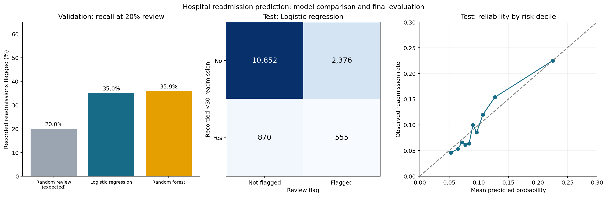

# Predicting hospital readmission after discharge home

Can information available by discharge identify encounters involving patients with diabetes that will be followed by a **recorded inpatient readmission in less than 30 days**?

This portfolio project compares a constant-risk baseline, logistic regression, and one random forest using a historical public dataset. It demonstrates patient-aware evaluation, probability assessment, and the trade-off between review capacity, missed readmissions and false alarms.

## Main findings

The random forest increased validation recall at a 20% review capacity from **35.0%** to **35.9%**. That **0.87 percentage-point** gain did not meet the written 2-point improvement requirement, so **logistic regression** was retained. This was a practical model-selection rule, not a statistical significance test.

The selected model was then evaluated on **14,653 reserved test encounters from 10,987 patients**:

| Measure | Test result | Approximate 95% patient-bootstrap interval |
|---|---:|---:|
| ROC AUC | 0.657 | 0.641–0.674 |
| Average precision | 0.199 | 0.171–0.231 |
| Recall at 20% review | 38.9% | 36.3%–41.9% |
| Precision at 20% review | 18.9% | 17.1%–20.9% |

The test outcome rate was **9.7%**. The constant training-prevalence baseline had test average precision **0.097** and ROC AUC 0.500.

Reviewing the highest-scoring **2,931 encounters** flagged **555 of 1,425** recorded readmissions. It also flagged **2,376** encounters without a recorded <30-day readmission and missed **870** recorded readmissions. Follow-up capacity is an illustrative assumption, not a measured hospital constraint or evidence of benefit.

## Explore

- [Executed and commented Python notebook](hospital_readmissions_case_study.ipynb)
- [Tableau companion](tableau/Hospital_Readmissions_Dashboard_Verified.twbx), with aggregate data embedded; [instructions](tableau/README.md)
- [Interview talking points](INTERVIEW_GUIDE.md)
- [Final test metrics and uncertainty](reports/test_metric_intervals.csv)
- [Exploratory group checks](reports/test_subgroup_summary.csv)

The Tableau workbook is a local artifact, not an online publication. It embeds a snapshot of the notebook's aggregate results.

## Design and validation

- Source: 101,766 encounters, 71,518 patients, 130 US hospitals and integrated delivery networks, 1999–2008.
- Cohort: 73,244 encounters discharged home (disposition codes 1, 6 or 8); all ages retained. Deaths, hospice, facility discharges and unclear statuses are outside this cohort.
- Patient-disjoint partitions: training 44,065 encounters; validation 14,526; test 14,653. Each patient's eligible encounters appear in exactly one partition.
- Eleven planned predictors: age, admission type/source, encounter length and activity counts, and prior-year utilization counts. IDs and outcome fields are excluded.
- Imputation, categorical encoding and scaling fitted on training only. The chosen model remains fitted on training only; validation selects the approach without refitting.
- One forest configuration, no hyperparameter search. The selection record was written before test predictions. The rejected model was not evaluated on test.
- The 20% batch-ranking policy was specified before the initial validation results. The forest selection rule was specified after the logistic validation results but before the forest validation results. It was not independently preregistered.
- Final test intervals use 500 patient cluster-bootstrap samples. They describe test-sample uncertainty conditional on the fitted model and selection; they omit training and selection uncertainty.
- Exploratory race, gender and age checks use the same globally selected test flags. Small-group performance is suppressed. These checks do not establish fairness.

The raw source's overall outcome counts were inspected in Stage 1 before splitting. Test outcomes were reserved from model development after partitioning. The code was executed end to end; no test-based model changes were made.

## Reproduce

1. Use Python 3.12 (executed with 3.12.7) and install `requirements.txt`.
2. Download the original ZIP from [UCI](https://archive.ics.uci.edu/dataset/296/diabetes+130-us+hospitals+for+years+1999-2008) and save it as `data/raw/uci_diabetes.zip`.
3. Open the notebook from this folder and run all cells in order. Forest fitting and patient bootstrapping can take several minutes.

Rerunning regenerates aggregate reports and the local identifier-based partition manifest. Test evaluation is reproducible, but rerunning does not turn it into a new independent test. A fresh dependency installation has not been tested. The Tableau workbook is a snapshot and does not refresh itself when reports change.

## Limits

The dataset is historical and restricted to recorded care. A `NO` label does not prove complete follow-up or absence of readmission elsewhere. Planned and unplanned readmissions cannot be separated here. The home-discharge scope excludes many patients who may also be eligible for readmission prediction in practice. Calendar dates and hospital IDs needed for temporal or hospital-held-out testing are absent. Availability of encounter-total features in a production discharge workflow is not independently verified.

Results weight encounters equally, so people with more eligible encounters contribute more. Scores predict recorded readmission, not preventability, clinical need, the effect of treatment, or the benefit of a follow-up call. These results do not establish suitability for clinical deployment.

## Files and publishing

The `reports/` CSVs contain aggregate counts, performance, calibration bins and the model-selection record. The notebook contains saved outputs and plots. The source archive and local `data/processed/partition_manifest.csv` are excluded from Git and from the clean publishing package. No individual risk scores are exported.

Upload the contents of the separate clean publishing folder/package when using GitHub's browser upload. `.gitignore` applies to Git operations; it does not filter manual file uploads.

## Source

Clore, J., Cios, K., DeShazo, J., & Strack, B. (2014). *Diabetes 130-US Hospitals for Years 1999-2008*. UCI Machine Learning Repository. [DOI: 10.24432/C5230J](https://doi.org/10.24432/C5230J). CC BY 4.0.

This is a personal reanalysis of existing data, not a new clinical study or a causal intervention evaluation.
