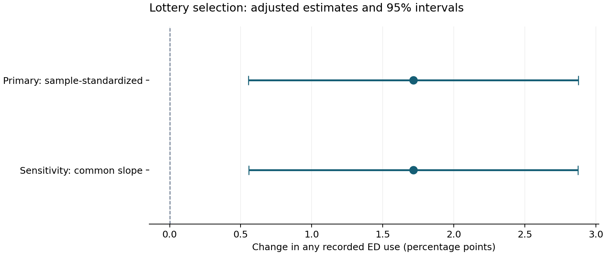

# Oregon Medicaid lottery and emergency-department use

A focused causal-inference case study using public data from the Oregon Health Insurance Experiment.

**Question:** Did being selected in the Medicaid lottery change the probability of any recorded emergency-department visit?

**Result:** Selection increased the adjusted probability by **1.72 percentage points** (95% CI **0.56–2.88**): about **17 additional people per 1,000** over March 10, 2008–September 30, 2009. One common-slope sensitivity model gives essentially the same estimate.

## Read the analysis

Open **[oregon_medicaid_case_study.ipynb](oregon_medicaid_case_study.ipynb)** for the question, design, essential checks, model, chart, and interpretation. Saved outputs allow review without running Python.

Open **[the Tableau dashboard](OHIE_Dashboard_Verified.twbx)** for interactive review. Circles show the adjusted estimates and horizontal lines show their 95% confidence intervals; the raw-rate panel is labeled descriptive. A separate worksheet shows baseline balance. The packaged workbook includes its aggregate data and does not require the source ZIP. It has not been published online.

## Approach

- Public-use ED sample: 24,646 people across 22,188 households; 9,626 selected and 15,020 controls.
- Outcome: any recorded visit at the 12 study hospitals during the documented calendar window.
- Primary analysis: linear probability model with categorical listed household size, lottery-selection interactions by size, and baseline any ED use. Contrasts are averaged over the sample composition.
- Uncertainty: household-cluster CR1 covariance with correction and a household-count-based t reference.
- Sensitivity check: common-slope selection model with the same size and baseline adjustment.

This estimates the **intention-to-treat effect of the opportunity to apply**, not the effect of enrolling in Medicaid. The model plan was recorded during the development stage before fitting the outcome model; this personal project was not independently preregistered.

## Interpretation and limits

The increase is modest in absolute terms, with statistical evidence against a zero effect under the documented study assumptions. It does not establish whether additional use was beneficial, preventable, or costly. The finding is limited to this lottery population and recorded care at study hospitals. The largest household-size category has only six controls. Original clinical matching and catchment construction cannot be independently reconstructed with the public release.

Raw rates are 34.14% selected versus 34.49% unselected. Their raw contrast is not the design-adjusted estimate, because selection probabilities differ by listed household size. The notebook explains why design-based adjustment matters.

## Reproduce

1. Use Python 3.12 (verified with 3.12.7) and install the packages in `requirements.txt`, for example `python -m pip install -r requirements.txt`.
2. Download the original `oregon_puf.zip` from the [OHIE data page](https://www.nber.org/research/data/oregon-health-insurance-experiment-data). Retain its original filename and internal folder structure.
3. Place it beside the notebook, or set the environment variable `OHIE_ZIP` to its absolute path.
4. Open the notebook in Jupyter and run all cells in order from this folder. Rerunning replaces `effect_estimates.csv` and `lottery_effect.png`.

The notebook reads the original archive directly; no intermediate analysis table or private workspace path is required. It prints the archive hash and verifies IDs, linkage, sample sizes, complete binary outcomes, and within-household assignment. Source archive SHA256 used here: `0426efe3c226ed39ce746322885cbf9bfabff26b759de282378ba1a0012f9e8a`.

## Files

- `oregon_medicaid_case_study.ipynb`: main analysis with executed outputs.
- `effect_estimates.csv`: aggregate primary and sensitivity estimates.
- `lottery_effect.png`: main figure.
- `requirements.txt`: numerical and plotting versions used, plus JupyterLab.
- `OHIE_Dashboard_Verified.twbx`: interactive Tableau dashboard with aggregate data embedded.
- `.gitignore`: excludes raw data, person-level tables, and local notebook artifacts.

This publishing folder contains only the files listed above. Raw data, person-level tables, source archives, and development notebooks remain outside it. Download the source archive separately to rerun the notebook. Publish this folder rather than the entire development directory.

## Validation

All four notebook code cells were rerun with the package versions in `requirements.txt`. The estimates and confidence limits match the development results. The figure and aggregate results were regenerated from the original archive. This verifies execution in the existing environment; a fresh dependency installation has not been tested.

The Tableau workbook is a local deliverable. Publishing it online is a separate step and requires a suitable Tableau edition and account.

## Sources

Finkelstein, Amy. *Oregon Health Insurance Experiment Public Use Data*, 2013. [Data and documentation](https://www.nber.org/research/data/oregon-health-insurance-experiment-data).

Taubman et al. (2014). *Medicaid Increases Emergency-Department Use: Evidence from Oregon’s Health Insurance Experiment.* [Study](https://pmc.ncbi.nlm.nih.gov/articles/PMC3955206/) · [Supplementary methods](https://economics.mit.edu/research/publications/appendices-medicaid-increases-emergencydepartment-use-evidence-oregons-health).

This project is a reanalysis of existing experimental data, not a new experiment or a full replication of the paper.
