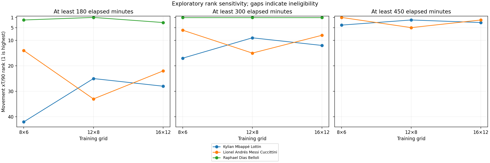
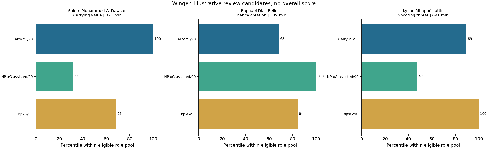

# Soccer recruitment analytics

**Which players warrant further scouting for a specific role and contribution style?**

This portfolio project turns public football events into explainable scouting-review candidates for strikers, central midfielders and wingers. It combines audited participation time, role-specific contributions, a historical Expected Threat (xT) baseline and sensitivity checks. A separate tracking-data demonstration develops movement features from an anonymized Metrica sample.

Start with the [scouting decision report](docs/scouting_case_study.md), then the [xT sensitivity case study](docs/xt_sensitivity_findings.md). Both are snapshots of the verified full-tournament analysis; the notebooks regenerate their underlying outputs.

## Selected findings

- A model fitted on **64 matches from the 2018 World Cup** assigned movement values to **45,546 selected successful passes and carries** in the 64-match 2022 tournament. Every eligible movement had training-zone coverage under the baseline grid.
- Mbappé and Messi had very similar baseline tournament movement-xT totals: **0.814 and 0.811**. Their narrow difference does not establish a meaningful superiority claim.
- At a **300-minute eligibility threshold**, each alternative grid retained **6 of the baseline's top 10** movement-xT/90 players. Exact shortlist membership depends on model specification.
- Separate contribution lenses generated three illustrative review candidates per role from pools of **14 strikers, 12 CMs and 20 wingers**. Selection reasons, sample limitations and next scouting questions are preserved; there is no overall weighted player score.



## How a scouting decision is formed

| Role | Contribution lenses | Illustrative selections in the verified run |
|---|---|---|
| Striker | Non-penalty chance generation, shot volume, shot quality | Breel-Donald Embolo; Olivier Giroud; Richarlison de Andrade |
| CM | Forward progression, chance creation, carrying value | Pedro González López; Mateo Kovačić; Yunus Dimoara Musah |
| Winger | Carrying value, chance creation, shooting threat | Salem Mohammed Al Dawsari; Raphael Dias Belloli; Kylian Mbappé Lottin |

Default eligibility requires at least 300 elapsed minutes, 50% of positioned events in the role, and complete eligible-movement xT coverage. Lens selection is sequential: choose the strongest remaining eligible player for each stated lens, avoiding duplicates within that role. This diversifies the examples; later selections are not necessarily the unrestricted metric leaders. Striker shot-quality selection also requires five non-penalty shots. See the report for exact rules and caveats.



## Reproduce the project

Use Python **3.11 or newer**; the full analysis and figures were verified with Python **3.12.7**. The analytical calculations use the standard library. JupyterLab supplies the notebook interface and matplotlib supplies the figures.

After cloning the portfolio repository, run these commands from its root on Windows:

```powershell
cd SoccerRecruitment
python -m venv .venv
.\.venv\Scripts\python.exe -m pip install -r requirements-notebooks.txt
.\.venv\Scripts\python.exe -m jupyter lab
```

On macOS/Linux, use `.venv/bin/python` instead of `.venv\Scripts\python.exe`. In Jupyter select that environment's kernel and run notebooks in order. Notebook 01 enables acquisition and feature generation on a fresh checkout; later runs can reuse cached files. No API keys or dataset ZIPs are needed. Public downloads require internet, can occupy hundreds of MB and may take several minutes. Keep the complete project folder together.

| Notebook | Purpose |
|---|---|
| [01 · Setup](notebooks/01_setup.ipynb) | Acquire, pin, verify and inspect source data |
| [02 · Player exploration](notebooks/02_player_exploration.ipynb) | Understand events, contributions and sample sizes |
| [03 · Minutes and per 90](notebooks/03_minutes_and_per90.ipynb) | Audit participation and adjust for exposure |
| [04 · Strikers](notebooks/04_striker_profiles.ipynb) | Expand to the full 2022 tournament and profile strikers |
| [05 · CMs and wingers](notebooks/05_cm_and_winger_profiles.ipynb) | Define role-specific event features |
| [06 · Expected Threat](notebooks/06_expected_threat.ipynb) | Fit on 2018 and attribute 2022 movement value |
| [07 · Robustness](notebooks/07_xt_robustness_and_case_study.ipynb) | Reproduce the baseline, compare specifications and inspect matches |
| [08 · Role shortlists](notebooks/08_role_based_shortlists.ipynb) | Generate transparent review candidates and decision reports |

The smaller command-line pipeline downloads three 2022 matches and Metrica Sample Game 1, then generates inspection/tracking reports:

```powershell
python scripts/run.py all
python -m unittest discover -s tests -v
```

The command-line starter does not run the full eight-notebook analysis. See [reproducibility notes](docs/reproducibility.md) for cache behavior, data pins, environment details and test scope. Notebook outputs are cleared for publication; selected figures and findings are retained in `docs/` so readers can inspect results without rerunning downloads.

## Methodology and practical limits

xT measures signed end-location minus start-location value for successful selected movements. The explicit fitting variant treats failed pass attempts and missed shots as zero-valued terminal transitions. Successful-action attribution does not directly penalize each player's turnovers. The action scope is limited to possessions labeled Regular Play or From Counter. Shooting remains separate; xG and xT are not added into an overall score.

Participation includes stoppage time and temporary injury absences but excludes halftime breaks and shootouts. Role assignment uses positioned-event share, not time in that role; features cover all roles played. CM and winger position sets and custom progression thresholds are documented. Sensitivity checks explore rankings and observed match contributions; they do not establish predictive calibration, causal impact or stable player ability.

The international tournament is short and selected. Team possession, opponent strength, match state, tactical assignment and off-ball contributions are not fully controlled. Transfer fees, wages, contracts, injuries and availability are absent. The case study supports further scouting review, not current transfer recommendations, financial undervaluation claims or recruitment ROI.

Metrica provides a separate anonymized tracking sample: **145,006 frames per team** in Sample Game 1. It cannot be joined to named StatsBomb players. About **39.1%** of its frames lack ball coordinates, limiting ball-distance analysis. See [methodology](docs/methodology.md) and the [model card](docs/model_card.md).

## Data and methodological attribution

Event analysis uses **[StatsBomb Open Data](https://github.com/statsbomb/open-data)**. Source data remains governed by its supplied terms and [license](https://github.com/statsbomb/open-data/blob/master/LICENSE.pdf).


Tracking demonstration data is provided by **[Metrica Sports](https://github.com/metrica-sports/sample-data)** and is acknowledged according to its README. Provider data is downloaded locally and excluded from this repository. Provider logos and data are not relicensed by this project.

The possession-value method is inspired by [Karun Singh's Expected Threat](https://karun.in/blog/expected-threat.html) and the [socceraction documentation](https://socceraction.readthedocs.io/en/latest/documentation/valuing_actions/xT.html). This implementation's action scope, failure handling and limitations are stated explicitly; it is not an exact reproduction of the reference library. See [third-party notices](THIRD_PARTY_NOTICES.md).
